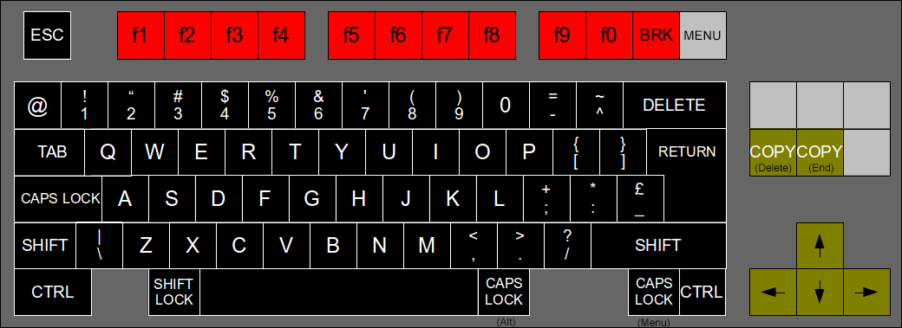

# BeebFpga_MiSTer

A BBC Micro Model B / Master 128 core for [MiSTer](https://github.com/MiSTer-devel), maintained by Paul Stewart ([Welsh71](https://github.com/Welsh71)).

This continues [sharpie7/BeebFpga_MiSTer](https://github.com/sharpie7/BeebFpga_MiSTer), which brought the [BeebFPGA](https://github.com/hoglet67/BeebFpga) emulation by David Banks ([hoglet67](https://github.com/hoglet67)) and others onto the harness of the [official MiSTer core](https://github.com/MiSTer-devel/BBCMicro_MiSTer). That project has not been updated since 2022, so new work and releases now happen here. All credit for the original port and emulation goes to those authors.

**Downloads:** the current core is **`BBCMicro.Alternate._YYYYMMDD.rbf`** (newest date) in the [`releases/`](releases) folder, and it is also attached to each version on the [Releases page](https://github.com/Welsh71/Welsh71BeebFpga_MiSTer/releases). The older `BBCMicro_2022....rbf` and `BBCMicro_ICE_2022....rbf` files in `releases/` are sharpie7's original 2022 builds, kept for reference only.

## What's new in this version

- **Intel 8271 disc controller with Acorn DFS 1.20 for the Model B**, as fitted to most early Beebs and used by BeebEm by default. It is now the Model B's default disc system, with the 1770 and DFS 2.26 still available from the menu. Software that drives the 8271 directly, and that won't run on a 1770, can now be used. See [Filing Systems](#filing-systems).
- **Current MiSTer framework** (October 2026 `sys`), so the core works with today's Main_MiSTer, scaler, HDMI and analogue output options.
- **Cassette tape loading** from `.UEF` files (plain or gzip-compressed) via the OSD, with a real MC6850 ACIA and Serial ULA emulation and cassette demodulator. Includes rewind, eject, tape sound (Low / Medium / Loud / Off) and an option to take tape input from the I/O board's ADC instead of a file. See [Cassette Tape](#cassette-tape).
- **Video timing accuracy fixes** ported from hoglet67's 2022 BeebFPGA work (6845, SAA5050, 6522, video ULA and clock slots), fixing split-screen games such as Elite and Revs.
- **Floppy disc improvements**: Write Track is now handled properly, so `*FORM` works; the drive activity LED is driven; and there is an optional on-screen disc status display (OSD: *Disk Status* Off / On / On Activity).
- Timing-closure work across the design for a more reliable 96 MHz build.

This core supports the original features of the MiSTer core:
- BBC Model B and Master 128 emulation
- Correct CPU for each model for best compatibility: 6502 for BBC Model B, 65C02 for Master 128
- Optional co-processor module with 65C02
- Support Secondary SD card as well as images on Primary SD card
- Scandoubler with HQ2x for all modes
- Support for analogue joysticks
- Emulation of joystick with mouse
- Support for RTC module to drive RTC on Master 128
- Analogue video out that closely resembles a real BBC Micro

This core also supports the following additional features:
- MMFSv2 allowing SSD files stored on the secondary SD card to be accessed directly.
- DFS support to access SSD files on both the BBC B and the Master 128
- Rounded characters in Mode 7
- Music 5000 sound add-on
- Improved compatibility with various software
- Enhanced keyboard mapping
- In Circuit Emulator debugger for machine-code level debugging (optional)

## Installing and Using

### Main Version

Most users will just want the main version described here.

Download the latest `BBCMicro.Alternate._YYYYMMDD.rbf` from the [`releases/`](releases) folder or the [Releases page](https://github.com/Welsh71/Welsh71BeebFpga_MiSTer/releases) and copy it to the `_Computer` or `_Computer/_Alternative` folder on the root of the MiSTer primary SD card. You can then select the file from the MiSTer boot menu or set to autoboot by editing the `bootcore` in `MiSTer.ini`.

The file is named `BBCMicro.Alternate._...` so it is easy to tell apart from the official BBC Micro core (`BBCMicro_YYYYMMDD.rbf`), which `update_all` installs and updates. The two can sit side by side, and `update_all` will not replace or remove this one. Both cores use the same `games/BBCMicro` folder for disc and tape images.

### ICE (In Circuit Emulator) Version

The ICE (In Circuit Emulator) Version contains special functions to enable debugging of system operation at the level of 6502 instructions. This is intended for advanced users who need a machine code level monitor/debugger. Most users can skip this section.

The ICE Version includes the [AtomBusMon](https://github.com/hoglet67/AtomBusMon) debugger for the main CPU on the BBC B and Master 128. Due to memory limitations the ICE Version does not support sideways RAM in ROM slots 4-7, the co-processor, or the Music 5000.

Copy the file `releases/BBCMicro_ICE_YYYYMMDD.rbf` to the `_Computer` or `_Computer/_Alternative` folder on the root of the MiSTer primary SD card. 

The AtomBusMon interface is connected to an internal UART that is accessible via the Hard Processor System (HPS) on the DE-10 Nano. To access this from a host computer perform the following steps:
- Connect a computer to the `UART` USB port on the DE-10 Nano.
- On the computer open a serial terminal to the DE-10 Nano at 115200 baud.
- Logon to the MiSTer Linux command line on the DE-10 Nano using the user ID `root` and password `1`. You may need to send a `return` character to get a logon prompt.
- From the Linux command line connect to via the internal UART to the ICE. This can be done with the command `picocom -b115200 --omap delbs /dev/ttyS1` (i.e. connect to serial device `/dev/ttyS1` at 115200 BAUD with the Delete key mapped to backspace).
- For how to use the ICE refer to the [AtomBusMon Wiki](https://github.com/hoglet67/AtomBusMon/wiki).
- Note that you may get some logging messages from Linux mixed in with the AtomBusMon output!
- To quit picocom use `Ctrl-A Ctrl-X`.

Note that AtomBusMon is loaded with the 65C02 software branch. This can be used on both the BBC B 6502 and the Master 128 62C02, but it won't correctly disassemble "illegal" 6502 opcodes.


## Filing Systems

There are several filing systems supported, and this may seem confusing. As different options support different requirements it seems best to provide the flexibility. One complicating factor is that MiSTer can support two SD cards that are accessed via different means. The primary SD card (on the DE10 Nano) is accessed via the Hard Processor System and presents an API interface to the MiSTer core. The secondary SD card (on the MiSTer expansion) is directly connected to the MiSTer core.

The **Filesystem** menu is different for each model:

- **Model B:** DFS 1.2 only (the default), DFS 1770 only, MMFSv1, MMFSv2, MMFSv1 & DFS 1.2, MMFSv1 & DFS 1770, MMFSv2 & DFS 1.2, MMFSv2 & DFS 1770.
- **Master 128:** MMFSv1 (the default), MMFSv2, DFS, MMFSv1&DFS, MMFSv2&DFS. The Master always uses its 1770.

Changes take effect at the next reset. If in doubt, use DFS 1.2 on the Model B for `.ssd`/`.dsd` disc images, and MMFS v1 for MMB collections.

### MMFS v1

[MMFS v1](https://github.com/hoglet67/MMFS) is the default filing system on the Master 128. 

MMFSv1 uses files in “MMB” format. This was a format originally developed for a BBC Micro add-on that connects SD cards to the user port and makes it look like a virtual set of disk-drives. The MMB file is a bundle of hundreds of BBC floppy disk images. Using commands on the BBC Micro you can choose to mount the images from the file into virtual drives.

The BBC core offers two ways to mount the MMB file. If you have a secondary SD card then format as FAT32 or FAT16. Copy the MMB file as “BEEB.MMB” on to the card. The core will automatically pick up that card. In this mode the file can be both read and written.

The alternative copy the MMB file to the “games/BBC Micro” directory on the main SD Card. If it is renamed “boot.vhd” then it will be automatically loaded. If not then you can manually load it from the MiSTer menu. In this mode the file is **read only**. To unmount a previously mounted MMB/VHD (e.g. to go back to the secondary card) press backspace when picking the file.

```
Some useful MMFS Commands:
 *DCAT [start #] [end #]   - List disks in the MMB file
 *DIN [Drive #] <Disk #>   - Mount disk in the specified drive (default 0)
 ```

For a handy MMB file with a good selection of BBC games try the "BEEB.MMB File v1.02" available [from RetroClinic](http://www.retroclinic.com/docs/index.htm).


### MMFS v2

An alternative filing system of [MMFS v2](https://github.com/hoglet67/MMFS) may be selected from the MiSTer menu. In MMFSv2 you can access SSD disk files on a FAT 32 formatted SD card in the secondary slot. Alternatively, you can pick an a file which is disk image (IMG) on the primary SD card and read SSD files from that.

### Acorn DFS

In DFS mode you can mount individual SSD and DSD files from the primary SD Card. The Model B can use either of Acorn's two disc systems:

- **DFS 1.2** (Model B default): Acorn DFS 1.20 with an emulated Intel 8271 controller, the original BBC Micro disc system. This is the best choice for older software, especially games that drive the disc controller directly and fail with a 1770.
- **DFS 1770**: Acorn DFS 2.26 with an emulated WD1770 controller, as on the later 1770 upgrade boards.

The Master 128 always uses its own DFS with the 1770.

The 8271 is a behavioural model written for this core (see `rtl/i8271`). It covers the commands DFS 1.20 uses, with realistic timing. Copy-protected discs that rely on non-standard track formats need a disc image format that records them (such as `.fsd`), which isn't supported yet.

### MMFS and DFS

Both MMFS and DFS may be activated at once. However, I am told by the author of MMFS: "It's generally not recommended to have both MMFS and DFS fitted and active at the same time, as they both use they the file system number, so things get very confusing. This is done to maximise compatibility with games that check specifically that DFS is the current file system by testing the file system number."

If you have both active then note that MMFS will treat `*DISC` and `*DISK` commands as belonging to it. Type `*OPT 5,1` to disable this, then `*DISC` to switch to the floppy DFS. `*CARD` switches back to MMFS.

If you have both active then for the Master 128 you can choose which to have as default (it will put the right value in the CMOS). On the Model B the highest numbered ROM (MMFS) will be the default.

## Cassette Tape

The core emulates the BBC's cassette interface (MC6850 ACIA at &FE08 and the Serial ULA at &FE10), so the normal tape filing system in MOS works.

1. Put your `.uef` files in the `games/BBCMicro` folder on the MiSTer SD card. Compressed (gzipped) UEFs work too.
2. In the OSD choose **Load Tape** and pick a file. The menu confirms when the tape is ready.
3. On the BBC type `*TAPE` (needed if a disc filing system is active), then `CHAIN""` or `*RUN`, as you would on a real machine. The tape runs whenever the motor relay is on.

Other options:
- **Rewind Tape** - go back to the start of the tape.
- **Eject Tape** - unload the tape image.
- **Tape Input: File / ADC** - use a loaded UEF, or a real cassette player connected to the I/O board's audio input.
- **Tape Sound** - hear the tape while it loads, at Low, Medium or Loud volume, or Off.

## Hardware

The simulated machines are pretty close to the standard configurations.

The BBC B has an Intel 8271 Floppy Disc Controller fitted (DFS 1.2 options), or an FC1770 (DFS 1770 options). The mouse is connected to a VIA at the normal User VIA address. There is an extra VIA at the &FEA0 (normally Econet) that is connected to the secondary SD card.

The Master 128 also has a mouse is connected to a VIA at the normal User VIA address. The SD card is connected to the VIA at &FE80.

## ROMS

In both machines, ROM slots 4-7 contain RAM which can be loaded with additional ROMs.

### BBC B ROMS

The following ROMs are fitted:
```
Slot  3 - DFS (If active): DNFS 1.20 (DFS 1.20 + NFS 3.60) with the 8271, or DFS 2.26 with the 1770
Slot  8 - MMFS (If active)
Slot 15 - RAM Master v6
Slot 16 - Basic
```

I've got mixed feelings about RAM Master. I can't find any documentation or source for it. It's a bit intrusive, but also useful so I've kept it in. There is enough information in `*HELP RAM` to workout most of the commands.

### Master 128 ROMS

The following ROMS are fitted:
```
Slot  3 - MMFS (If active)
Slot  9 - DFS (If active)
Slot 10 - View Sheet
Slot 11 - Edit
Slot 12 - Basic
Slot 13 - ADFS (Not supported)
Slot 14 - View
Slot 15 - Terminal 
```

## Keyboard Mapping

The keyboard mapping attempts to follow the physical layout of the BBC Micro as much as possible when mapped onto modern keyboards. The diagram below shows the BBC keys on a standard UK layout PC keyboard.

There may be more "Caps Lock" keys than you expect! This is to give some reasonable options for games that use Caps Lock and Control as left and right.

Note that Break is F11. Unlike the official MiSTer implementation you don't need to use Control to get the Break.



## Music 5000

The Music 5000 is an add-on for the BBC Micro supporting wave-table synthesis. At the time it was fairly rare though it had a cult following. It was an external box that connected to the BBC over the "1MHz Bus" port. Retrospectively it's had a second life though emulation and modern reconstruction of the hardware.

This emulation includes the Music 5000 hardware. To you use it you will need a ROM and suitable boot disk. (The original ROMs had a copy protection system that also needs to be patched out in the emulation).

I used the "Music 5000 System Disk" from [Colin Fraser's site](http://www.colinfraser.com/m5000/m5000.htm). His page contains instructions to use on a Master 128 (you may need to use `*OPT 4,3` to enable the shift-boot. If you are using via MMFS you will need to manually reselect the disk and reset again once the ROMs are loaded). 

To use on a BBC Micro you need to:
- Load the "Ample" ROM `R.AMPLE` into a sideways ROM slot
- Load the Ample Help File ROM `ANHF` into a sideways ROM slot
- Start the "Runner" file: `*EXEC runner`
- This should start the AMPLE environment. From the menu you can load an example, e.g. `concert`

There is also a lot of Music 5000 information and software on the [Retro-Kit](https://www.retro-kit.co.uk/Hybrid-Music-System/) site.

Aside: Back in the day I did have a Music 500 (essentially the same hardware as Music 5000). I could never get anything out of it that I thought sounded good and rapidly gave up trying. I am afraid all the demos I've heard now for Music 5000 don't improve my assessment! It always struck me as odd that what was at the time a pretty advanced system was still so "bleepy". Still, it has its fans and I am glad it's been rediscovered.

## Analogue Video Out

The core supports analogue video out on the VGA connector of the MiSTer expansion board, though the signals are not necessarily VGA compatible. If you are using HDMI output leave everything as default. If you want analogue output that is "like a real BBC" set `M7 Analogue Video` to `576i` in the menu. For more details see below. 

In Modes 0-6 the default analogue video from the core is interlaced 50Hz standard definition TV. This is not compatible with standard VGA, but can work with 16k monitors and with TVs using a suitable VGA-SCART cable and the right settings in `MiSTer.ini`. Interlace can be turned off using `*TV 0,1` followed by changing the Mode on the BBC Micro.

In Mode 7 the default analogue video from the core is 576p. This works well with the MiSTer HDMI scaler, but the analogue output isn't compatible with the other modes. In the menu you can set `M7 Analogue Video` to `576i` which is what a BBC Micro would output. This is similar to the interlaced outputs from other modes, and should work with the same displays, but doesn't display nicely on the HDMI output.

As it was back in the day, interlaced video will judder a little on some displays. Welcome to the past!


## Known Bugs and Limitations

- You must manually apply reset using the menu if you change the hardware configuration
- Sound mixing between the Music 5000 output and the BBC sound isn't good. Don't play both at once.
- Master 128 does not save its CMOS settings, though some important values can be configured via F12 OSD
- The "VideoNuLA" (a modern upgrade to the original VideoULA) is not supported.
- Selecting Drives 2 and 3 in DFS creates some odd results.
- Saving to tape (`*SAVE` with `*TAPE`) is not supported yet.
- The ICE version has not been rebuilt on the new framework; only the 2022 ICE builds in `releases/` are available.
- MiSTer's gamma correction setting has no effect on this core. It was removed to free block RAM for DFS 1.20; with the Beeb's 8 colours it made almost no visible difference.
- The 8271 doesn't yet support copy-protected disc images (`.fsd`).


## Some Development Notes

The Intel 8271 model was written for this core from the Intel data sheet, using [b-em](https://github.com/stardot/b-em)'s 8271 emulation (Tom Walker and the b-em developers) as the reference for how DFS 1.20 drives it.

Thanks to the excellent work already done by several people, and with the particular help of David Banks/[hoglet67](https://github.com/hoglet67), there weren't a lot of massive issues bringing this together.

The biggest problem was porting the FC1770 Floppy Disk Controller to the BBC B. [This site](http://www.adsb.co.uk/bbc/disk_controllers/) highlighted the important but obscure fact that the FC1770 is mapped to different addresses on the BBC B and the Master. What it doesn't mention is that also the bits in the "control register" are assigned to different values on the BBC B and Master. That took some finding.

There is also a check for the presence of the FC1770 in the Acorn BBC B DFS ROM that seems to rely on reset behaviour of the chip that wasn't quite working in the original simulation. (It writes to the TRACK register and then reads back - I believe while the reset line is held low). That required some effort to find.

Saving the CMOS for the Master 128 would be nice, but it seems that MiSTer only offers its simple option to write files if you use the NVRAM tag in an MRA file which I want to avoid as it makes the install messy.

There are some notes in the code on how to move between the normal version and the ICE version in the code. Note it requires modifying parameter in two files: BBCMicro.sv and bbc_micro_core.vhd.

